# Facet by Purrline Rocketworks  

Satellite parts for small launchers in [Kitten Space Agency](https://ahwoo.com/app/100000/kitten-space-agency), from the fictional rocket maker Purrline Rocketworks: a rideshare rack with cube satellites, and a kit to build small satellites and probes.

Validated against KSA build version 2026.11.10.5801.

*The launch video, made in the game with these mods.*

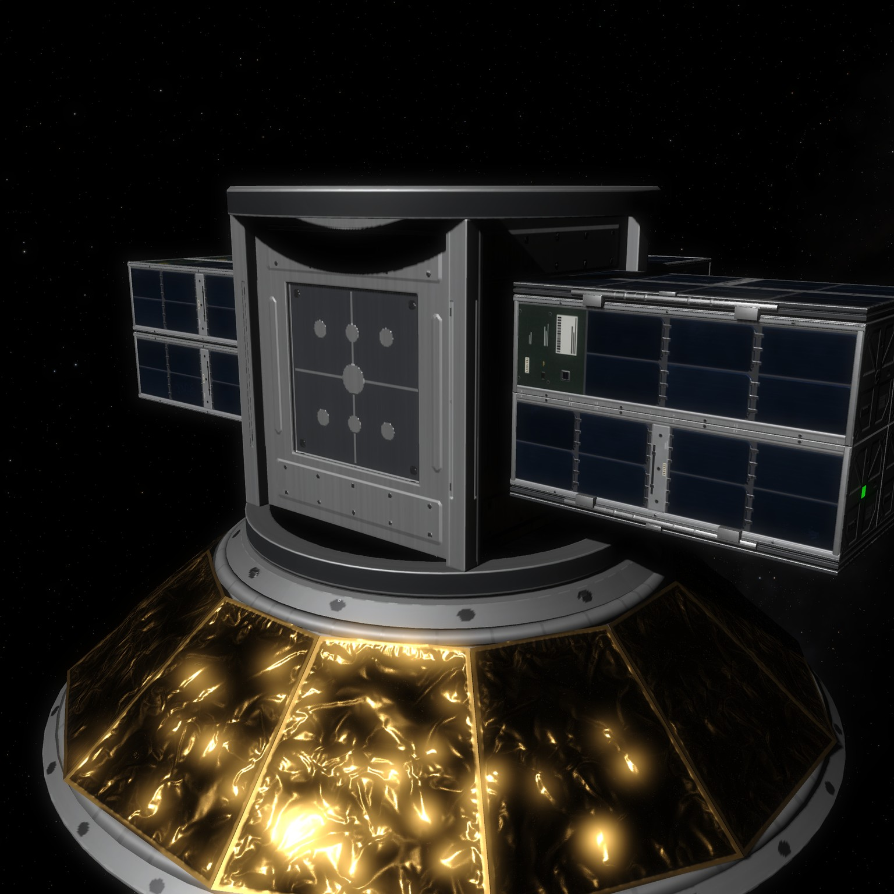

## Parts

| Picture | Part | What it is |
| --- | --- | --- |
| 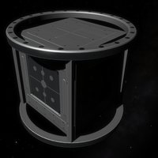 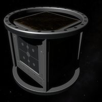 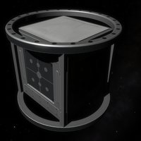 | **Facet Cube Rack** | Rideshare rack for cube satellites inside a fairing; bare, gold foil, white cloth |
| 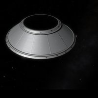 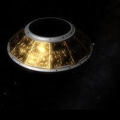 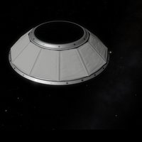 | **Facet Cube Adapter 1 m to 0.5 m** | Adapter from 1 m to 0.5 m; bare, gold foil, white cloth |
| 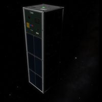 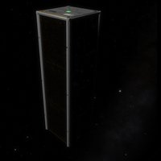 | **Facet Cube 3U** | 3U cube satellite; two layouts |
| 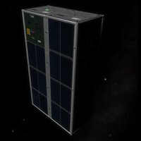 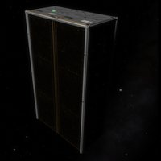 | **Facet Cube 6U** | 6U cube satellite; two layouts |
| 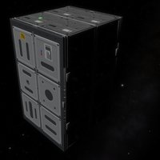 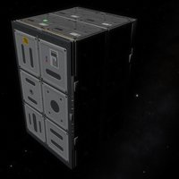 | **Facet Cube 12U** | 12U cube satellite that unfolds its wings; two layouts |
| 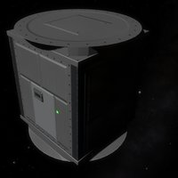 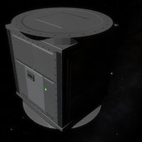 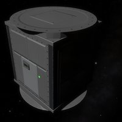 | **Facet Bus** | Core of a small satellite or probe; bare, gold foil, white cloth |
| 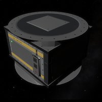 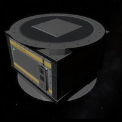 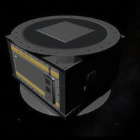 | **Facet Battery Pack** | Battery pack for the Bus; bare, gold foil, white cloth |
| 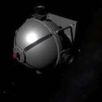 | **Facet RCS Pod** | Attitude control thrusters with their own tank |
| 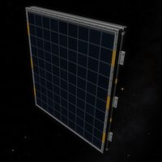 | **Facet Wing 2** | Folding solar wing, two panels |
| 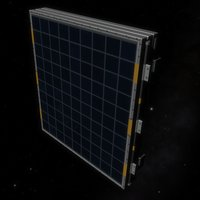 | **Facet Wing 3** | Folding solar wing, three panels |
| 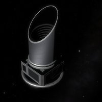 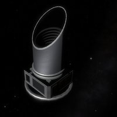 | **Facet Eye Imager** | Earth observation telescope; bare or with foil |
| 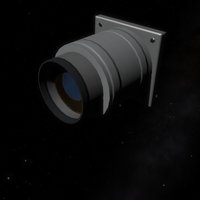 | **Facet Camera Pod** | Small camera |
| 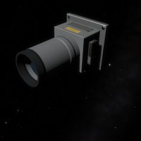 | **Facet Star Tracker** | Star tracker |
| 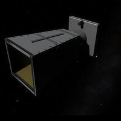 | **Facet Horn Antenna** | Horn antenna |
| 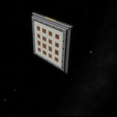 | **Facet Patch Antenna** | Patch antenna |
| 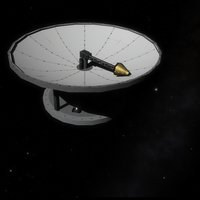 | **Facet Dish** | Deploying dish antenna |
| 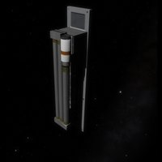 | **Facet Science Boom** | Deploying science boom |
| 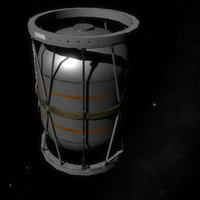 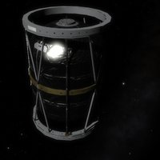 | **Facet Voyager Tank** | Propellant tank of a small probe; bare or in silver foil |
| 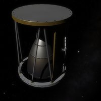 | **Alcor Kick Engine** | Kick engine on stock MMH and NTO |

All parts and finishes on one sheet: [images/parts/all-parts.jpg](images/parts/all-parts.jpg)

Rack, Adapter, Bus and Battery come bare, in gold foil or in white cloth; the Imager and the Voyager Tank also come with foil. Sizes and texture density follow the stock parts. A cube satellite leaves the rack with its decoupler and tumbles unless something controls it. A Bus rides on a stock 0.5 m decoupler.

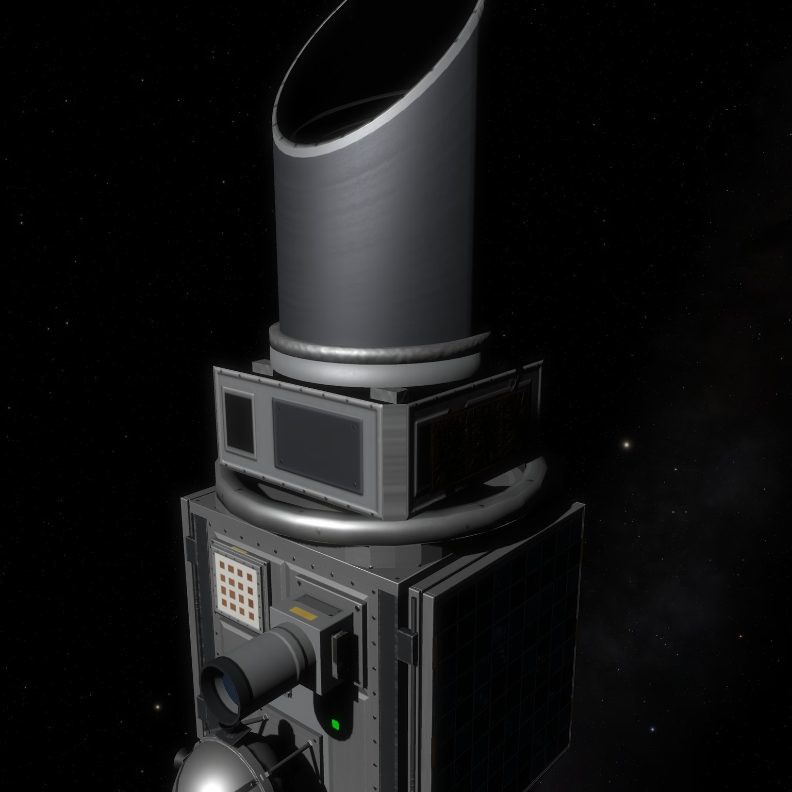

## Install

No other mod needed. Facet works with any launcher that has a fairing.

- Borea: install Facet from the content list.
- By hand: copy `PurrlineFacet` from the release zip into `Documents/My Games/Kitten Space Agency/mods/` and enable it.

To remove the mod, delete its folder. Vehicles with its parts do not load without it.

Works well with [Prisma by Purrline Rocketworks](https://github.com/Maximilian-Nesslauer/KSA-PurrlinePrisma), a small launcher with a fairing for Facet.

## Licence

Code and game data: MIT ([LICENSE](LICENSE)). Meshes, textures, logo and pictures: CC BY 4.0 ([LICENSE-ART](LICENSE-ART)). Credits: [NOTICE.md](NOTICE.md).

## Links

[Forum thread](https://forums.ahwoo.com/threads/facet-by-purrline-rocketworks.ID/) | [Issues](https://github.com/Maximilian-Nesslauer/KSA-PurrlineFacet/issues)
