# Facet by Purrline Rocketworks  

Satellite parts for small launchers in [Kitten Space Agency](https://ahwoo.com/app/100000/kitten-space-agency), from the fictional rocket maker Purrline Rocketworks: a rideshare rack with cube satellites, and a kit to build small satellites and probes.

## Compatibility

Validated against KSA build version **2026.11.16.5901**.

*The launch video, made in the game with these mods.*

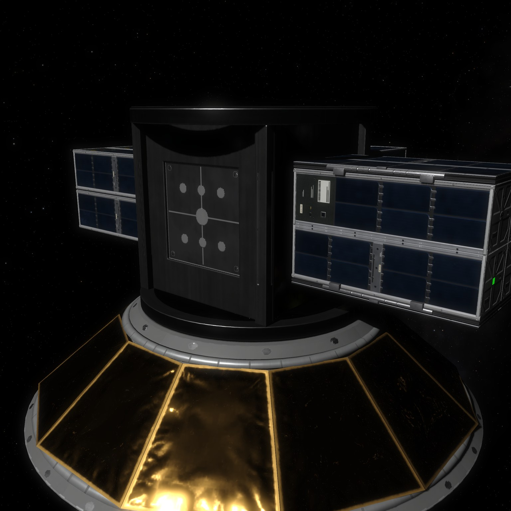

## Parts

| Picture | Part | What it is |
| --- | --- | --- |
| 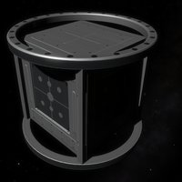 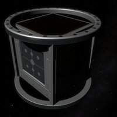 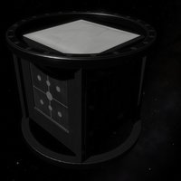 | **Facet Cube Rack** | Rideshare rack for cube satellites inside a fairing; bare, gold foil, white cloth |
| 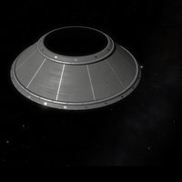 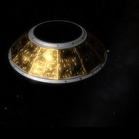 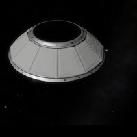 | **Facet Cube Adapter 1 m to 0.5 m** | Adapter from 1 m to 0.5 m; bare, gold foil, white cloth |
| 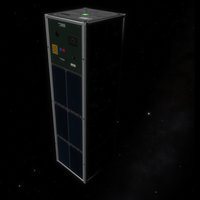 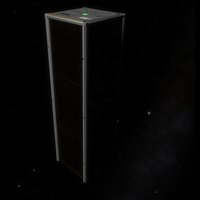 | **Facet Cube 3U** | 3U cube satellite with 1.5 W avionics in two layouts |
| 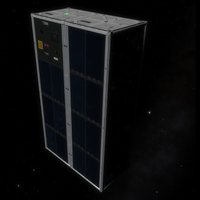 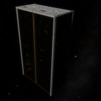 | **Facet Cube 6U** | 6U cube satellite with 3 W avionics in two layouts |
| 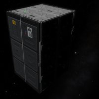 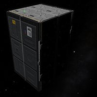 | **Facet Cube 12U** | 12U cube satellite with 6 W avionics and deployable wings in two layouts |
| 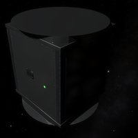 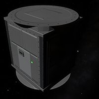 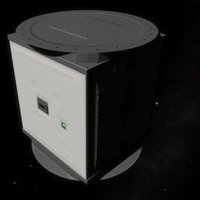 | **Facet Bus** | 25 W control core for a satellite or probe, in bare, gold foil or white cloth |
| 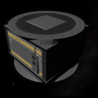 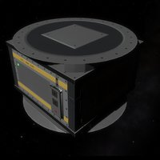 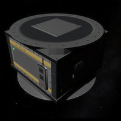 | **Facet Battery Pack** | Battery pack for the Bus; bare, gold foil, white cloth |
| 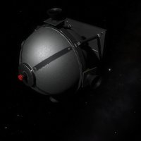 | **Facet RCS Pod** | Attitude control thrusters with a tank for about 11 kg of propellant |
| 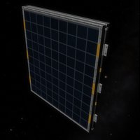 | **Facet Wing 2** | Folding solar wing, two panels |
| 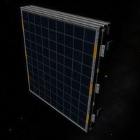 | **Facet Wing 3** | Folding solar wing, three panels |
| 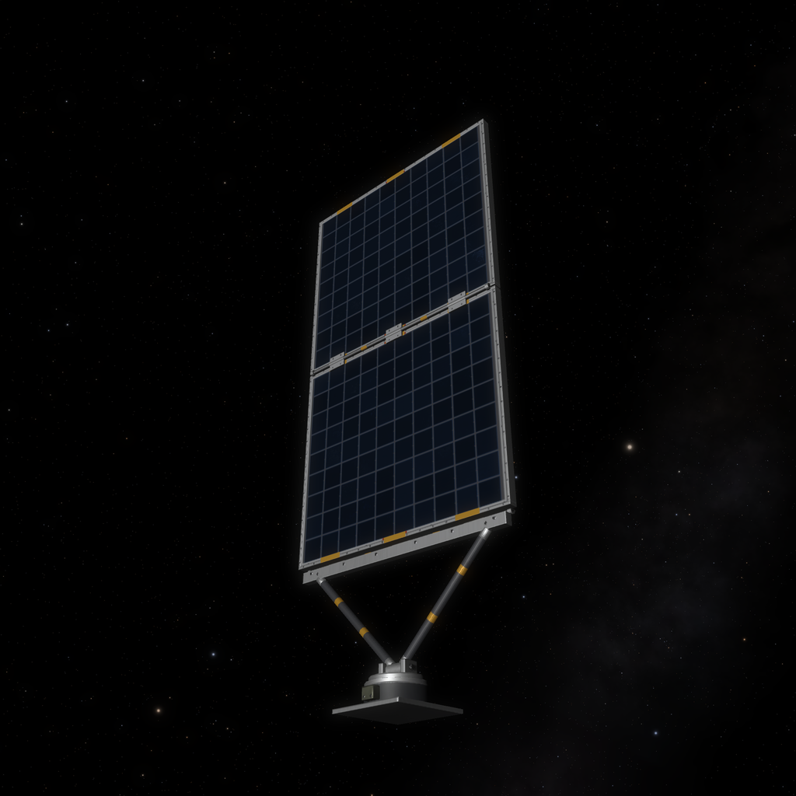 | **Facet Tracking Wing 2** | Two-panel folding solar wing with a single-axis drive, rated at 138 W |
| 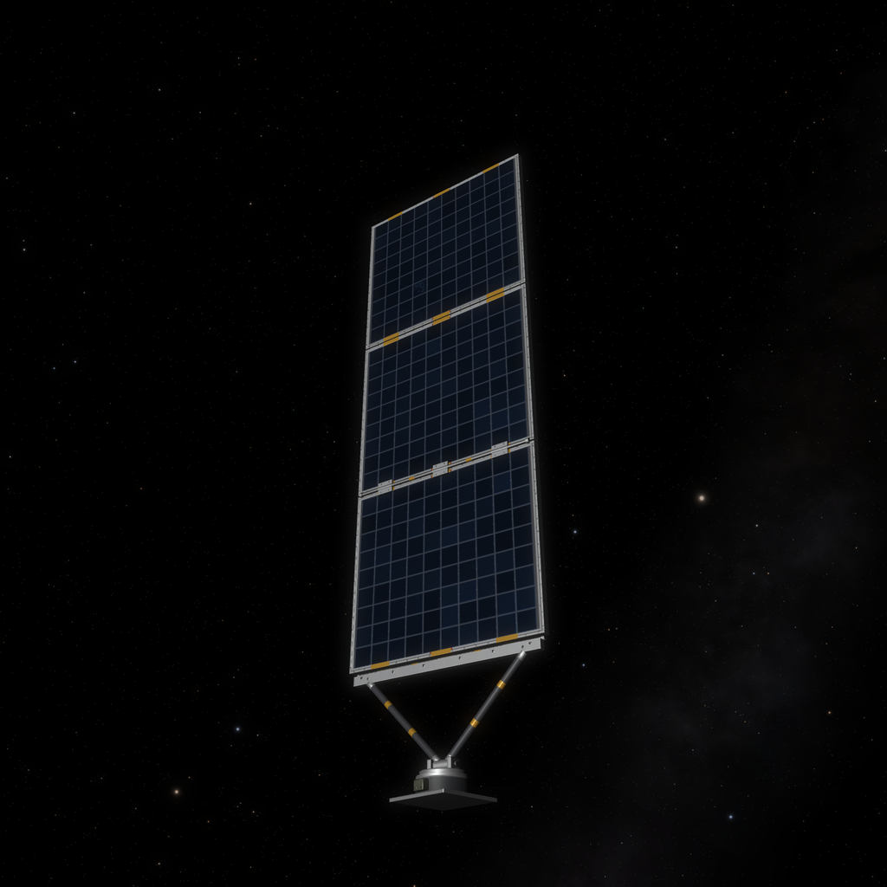 | **Facet Tracking Wing 3** | Three-panel folding solar wing with a single-axis drive, rated at 207 W |
| 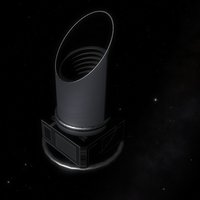 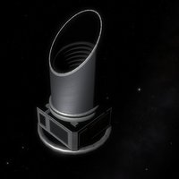 | **Facet Eye Imager** | Earth observation telescope with a 60 W switched power draw, bare or with foil |
| 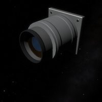 | **Facet Camera Pod** | Small camera with a 15 W switched power draw |
| 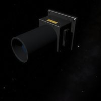 | **Facet Star Tracker** | Star tracker |
| 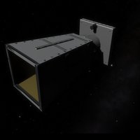 | **Facet Horn Antenna** | Horn antenna |
| 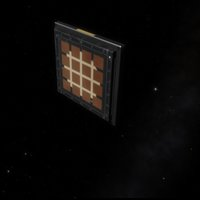 | **Facet Patch Antenna** | Patch antenna |
| 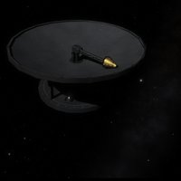 | **Facet Dish** | Deploying dish antenna |
| 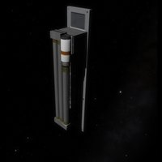 | **Facet Science Boom** | Deploying science boom |
| 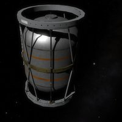 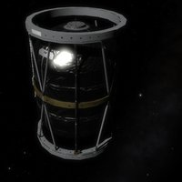 | **Facet Voyager Tank** | Tank for about 414 kg of propellant, bare or in silver foil |
| 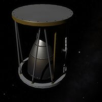 | **Alcor Kick Engine** | Kick engine on stock MMH and NTO with a gimbal slew limit of 6 degrees per second |

Original parts and finishes on one sheet: [images/parts/all-parts.jpg](images/parts/all-parts.jpg)

Rack, Adapter, Bus and Battery come bare, in gold foil or in white cloth; the Imager and the Voyager Tank also come with foil. Sizes and texture density follow the stock parts. A cube satellite leaves the rack with its decoupler and tumbles unless something controls it. A Bus rides on a stock 0.5 m decoupler.

The Bus and all three Cube sizes have power switches and status lights for their avionics. The Bus has a radiation tolerance of 1000 Gy, an upset dose of 900 mSv and 1 g/cm2 of shielding. Each Cube has a tolerance of 50 Gy, an upset dose of 45 mSv and 0.5 g/cm2 of shielding.

Deploy a Tracking Wing to let it turn toward the Sun at up to 5 degrees per second. Saved vehicles keep their original wings and those wings work as before in flight.

The editor uses the physical shapes of the Bus and Battery Pack for surface attachments. Place the Battery Pack and Cube Adapter on stack connectors. The original wings and the Patch Antenna have new viewing angles in the part picker.

The Voyager Tank and RCS Pod propellant capacities use the corrected stock liquid MMH density of 880.58 kg/m3 in KSA 2026.11.16.5901. Their tank volumes are unchanged.

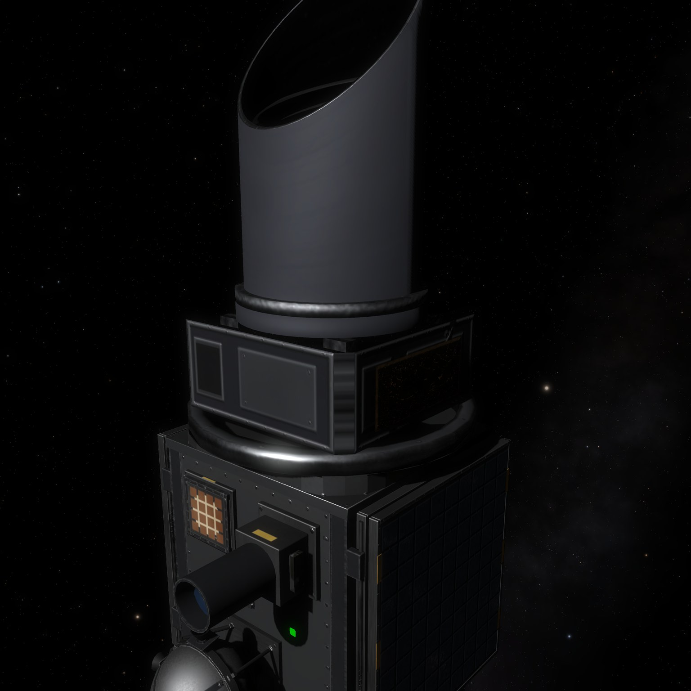

## Install

Facet works with the base game and can fly on any launcher with a suitable fairing.

- Borea: install Facet from the content list.
- By hand: copy `PurrlineFacet` from the release zip into `Documents/My Games/Kitten Space Agency/mods/` and enable it.

To remove the mod, delete its folder. Vehicles with its parts do not load without it.

Works well with [Prisma by Purrline Rocketworks](https://github.com/Maximilian-Nesslauer/KSA-PurrlinePrisma), a small launcher with a fairing for Facet.

## Licence

Code and game data: MIT ([LICENSE](LICENSE)). Meshes, textures, logo and pictures: CC BY 4.0 ([LICENSE-ART](LICENSE-ART)). Credits: [NOTICE.md](NOTICE.md).

## Links

[Forum thread](https://forums.ahwoo.com/forums/kitten-space-agency/mod-releases/facet-by-purrline-rocketworks.1634/) | [Issues](https://github.com/Maximilian-Nesslauer/KSA-PurrlineFacet/issues)
